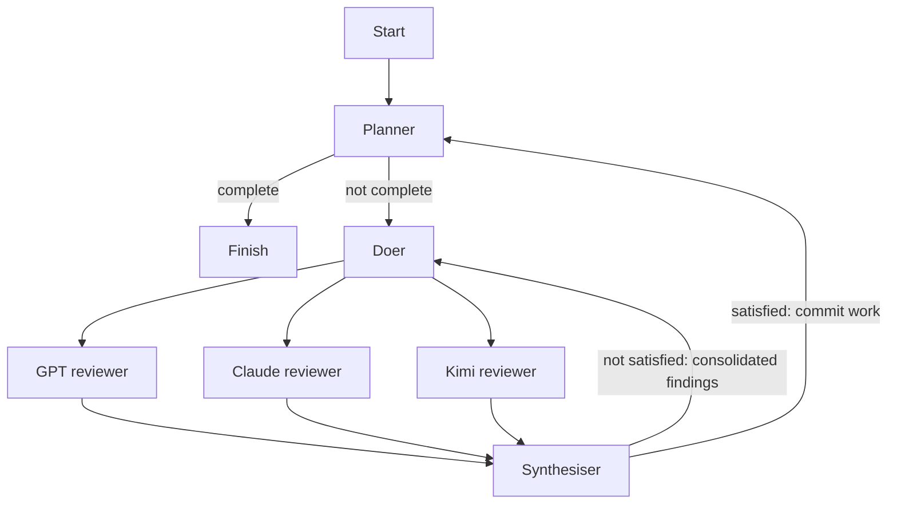

# Tetris 005 — Three big brains

A fresh target for the iteration 005 assembly-line experiment, built from
`tetris/spec.md`. The game and its plan have not been generated yet.

The doer's current-task work fans out to three concurrent reviewers. All use
the same prompt and the shared testability lens at
`.assembly-lines/.machines/lens.md`; only their models differ.

| Machine | Pi model |
| --- | --- |
| reviewer_1 | `openai-codex/gpt-6.1-sol` |
| reviewer_2 | `openrouter/anthropic/claude-opus-5.5` |
| reviewer_3 | `openrouter/moonshotai/kimi-k3` |
| planner | `openai-codex/gpt-6.1-sol` |
| doer, synthesiser (final validation decision) | `openai-codex/gpt-5.6-terra` |

Kimi K3 is pinned to the standard model ID, rather than the moving
`moonshotai/kimi-latest` alias or the batch variant. Pi's local catalog and
[OpenRouter's model page](https://openrouter.ai/moonshotai/kimi-k3) confirm the ID.
Pi needs working authentication for `openai-codex` and `openrouter`.



Reviewers report without editing files. The synthesiser receives only their
JSON reports plus its configured instructions, waits for all three, and decides.
A failed branch stops the run before synthesis or a work commit. Rejection
retries the same task; the default limit is three doer attempts per task.

From the repository root, validate the line without calling models:

```sh
bin/factory --check-line --target tetris/tetris-005-openrouter --line careful
```

Build the game with real model calls:

```sh
bin/factory --run tetris-005-openrouter --target tetris/tetris-005-openrouter --line careful --seed tetris/spec.md
```

The first build remembers its settings in
`factory/runs/tetris-005-openrouter/run.json`. The plan stays alongside that file
in `plan.md`, outside the target. Resume with:

```sh
bin/factory --run tetris-005-openrouter
```

Once the factory has generated the game, test and play it with:

```sh
npm --prefix tetris/tetris-005-openrouter test
npm --prefix tetris/tetris-005-openrouter start
```
