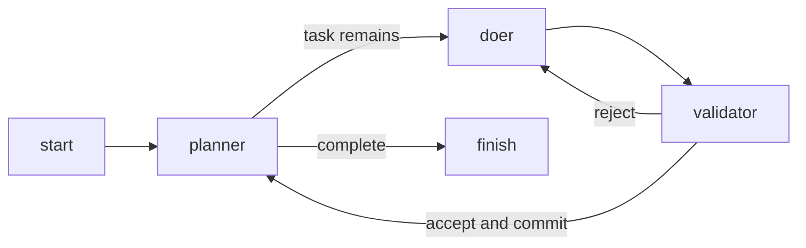

# Tetris 007: planner, doer, validator

The `careful` line builds a fresh terminal Tetris game from `tetris/spec.md`:



The planner writes a short task plan. The doer implements the first unfinished
task. The validator checks that task's changed work for functional correctness
against the seed, including relevant tests, startup and the 24-row display limit.
Findings return to the doer for another attempt. Accepted work is committed before
the planner marks the task done. The run finishes when the plan is complete.

| Machine | Model |
| --- | --- |
| `planner` | `openai-codex/gpt-6.1-sol` |
| `doer` | `openai-codex/gpt-5.6-terra` |
| `validator` | `openai-codex/gpt-6.1-sol` |

All three use `pi-rpc-acp`. The default limit is three attempts per task.
The plan and events belong in `factory/runs/tetris-007/`.

Validate the configuration without calling models:

```sh
bin/factory --check-line --target tetris/tetris-007 --line careful
```

Start a fresh run from the repository root:

```sh
bin/factory --run tetris-007 --target tetris/tetris-007 --line careful --seed tetris/spec.md
bin/factory watch tetris-007
```

After the first start, resume with `bin/factory --run tetris-007`.
While the doer is working, steer it with:

```sh
bin/factory say tetris-007 doer "Keep the complete display within 24 rows"
```

The previous plan-first run's plan, review state and events were moved together
under `factory/runs/archive/tetris-007-plan-first-<timestamp>/`. The next start
creates a fresh plan and run record using this simpler line.
