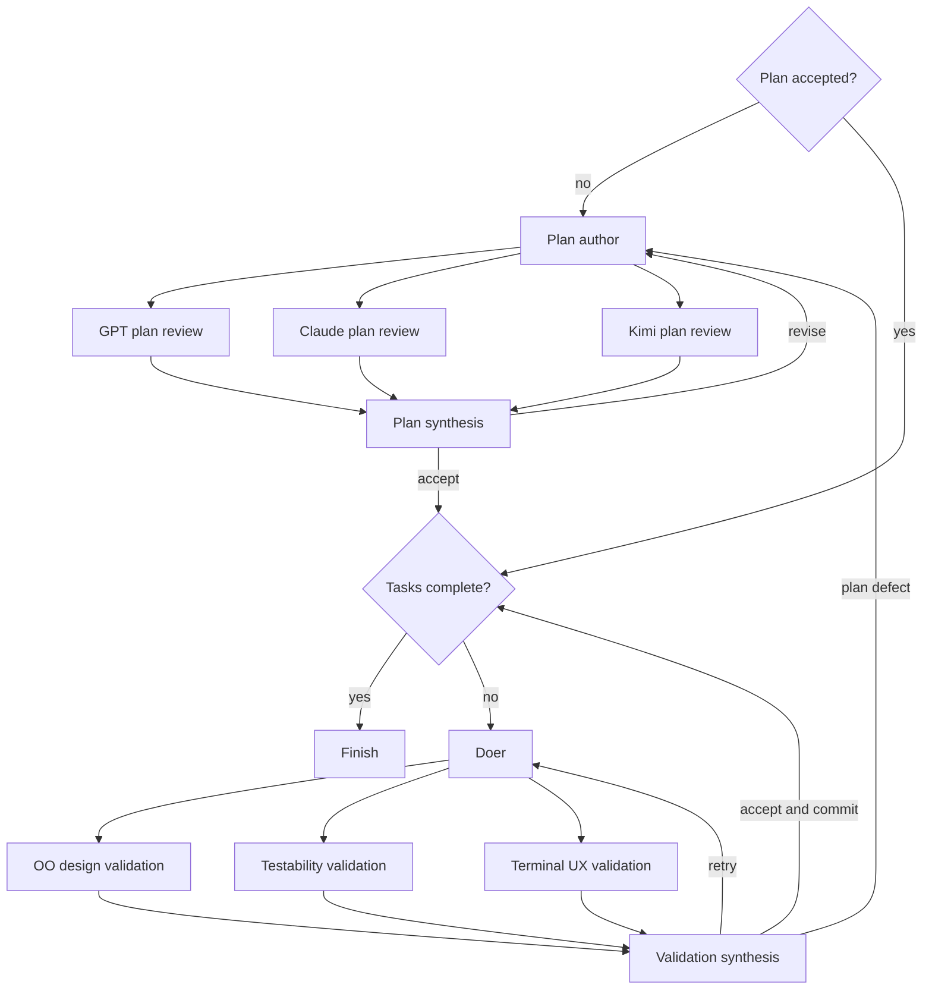

# Tetris 007: plan review, then validation through three lenses

This target starts from `tetris/spec.md`. The factory writes its plan and review
history under `factory/runs/tetris-007/` and builds the game in this target.

The `plan-first` line has two parallel review stages:

| Stage | Machine | Model | Lens |
| --- | --- | --- | --- |
| Plan author | `plan_author` | GPT-6.1 Sol | Comprehensive behavior, contracts and tasks |
| Plan review | `plan_reviewer_1` | GPT-6.1 Sol | Full plan |
| Plan review | `plan_reviewer_2` | Claude Opus 5.5 via OpenRouter | Full plan |
| Plan review | `plan_reviewer_3` | Kimi K3 via OpenRouter | Full plan |
| Plan decision | `plan_synthesiser` | GPT-6.1 Sol | Reconcile reports and record every finding's disposition |
| Progress | `planner` | GPT-6.1 Sol | Mark committed tasks done |
| Implementation | `doer` | GPT-5.6 Terra | First unfinished task in the accepted plan |
| Validation | `validator_objects` | GPT-6.1 Sol | Responsibility-driven OO design |
| Validation | `validator_tests` | GPT-6.1 Sol | Testability and acceptance evidence |
| Validation | `validator_terminal` | GPT-6.1 Sol | Terminal UX, 24-row display and lifecycle |
| Work decision | `validation_synthesiser` | GPT-6.1 Sol | Accept, retry implementation, or repair the plan |

The three plan reviewers receive the same revision and the same combined lens:
gameplay/scope, object responsibilities, testability and terminal experience.
They differ by model. The three implementation validators use the same model
and differ by lens. Each receives the same current-task diff and accepted plan.
All model machines run through `pi-rpc-acp`.



Both synthesisers decide from reports; acceptance is based on evidence rather
than votes. Implementation starts only after plan acceptance. Successful work
validation commits the task before the planner marks it done. A plan defect
returns through the author and all three plan reviewers without committing the
rejected work or advancing the current task.

`validation_synthesiser` deliberately has role `plan_validator`: the factory
checks its exclusive `satisfied`/`retry`/`replan` decision and uses its acceptance
to permit a commit. The branch validators also use `plan_validator` so their
reviews include the accepted plan, task identity and repair context.

The local `plan_gate` uses no model and skips a new planning round on resume
when a plan is already accepted. Planning is limited to three review rounds
per episode; implementation is limited to three attempts per task per
invocation. Repairing the plan does not reset the current task's attempt count.

Validate the graph without calling models, from the repository root:

```sh
bin/factory --check-line --target tetris/tetris-007 --line plan-first
```

Start the build with the configured models:

```sh
bin/factory --run tetris-007 --target tetris/tetris-007 --line plan-first --seed tetris/spec.md --plan-rounds 3 --attempts 3
bin/factory watch tetris-007
```

Resume later with `bin/factory --run tetris-007`. While a machine is running,
steer it by its graph name, for example:

```sh
bin/factory say tetris-007 doer "Keep gameplay independent of terminal input and rendering"
bin/factory say tetris-007 validator_terminal "Check the game-over display against the full 24-row budget"
```

Messages apply to the active attempt; lasting instructions belong in the seed,
plan or machine configuration. Once the game has been generated, play it with
`npm --prefix tetris/tetris-007 start`.
